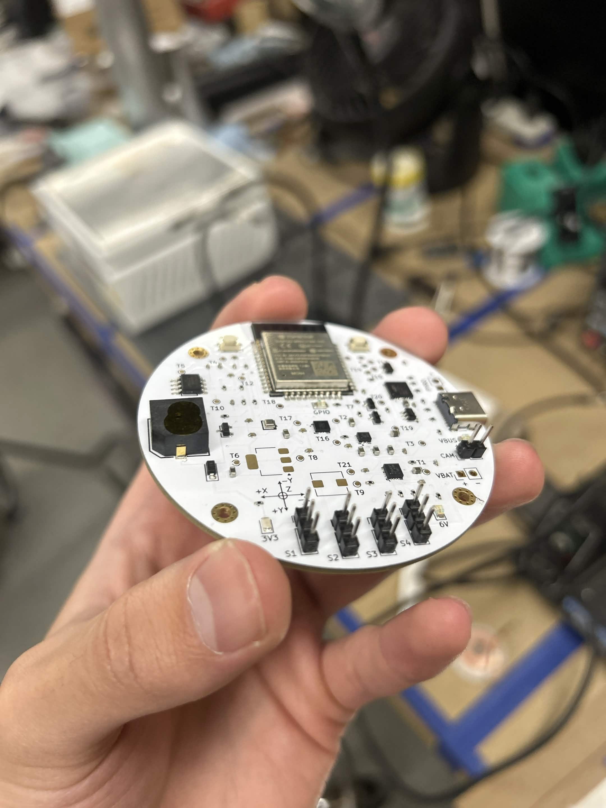
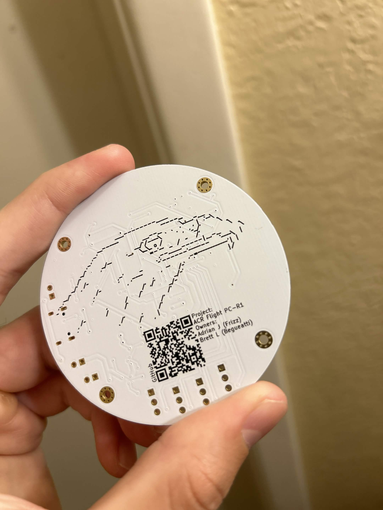

# EAGLE Flight Computer
 
EAGLE is a custom ESP32-based flight computer for an actively controlled, canard-steered rocket.
 

  
  &nbsp;
  

## Contents
 
- [Features](#features)
- [Hardware](#hardware)
- [Pin map](#pin-map)
- [Firmware](#firmware)
- [Roadmap](#roadmap)
- [Credits](#credits)
  
## Features
 
- **ESP32-WROOM-32E** (4 MB flash) with Wi-Fi and Bluetooth
- **6-axis IMU** with a ±32 g accelerometer range
- **Barometric altimeter** for altitude and apogee detection
- **Four servo outputs** on a dedicated 6 V rail for canard actuation
- **One pyro channel** with continuity sensing
- **F-RAM storage** for persistent Data Logging
- **Automatic power switching** between battery and USB
- **Battery voltage monitoring**, buzzer, status LED, and 21 test points
- **USB-C** for flashing and serial monitor, with auto-reset
- 
## Hardware

| Block | Part | Interface | Notes |
|---|---|---|---|
| MCU | ESP32-WROOM-32E-N4 | | Dual-core, 4 MB flash |
| IMU | LSM6DSO32 | SPI | 6-axis accel + gyro, up to ±32 g |
| Barometer | BMP581 | SPI | Shares the SPI bus with the IMU |
| Storage | FM24W256 | I2C (`0x50`) | 256 kbit F-RAM |
| USB-UART | CP2102N | UART0 | DTR/RTS auto-boot circuit |
| USB protection | USBLC6-2SC6 | | ESD protection on D+/D− |
| Power mux | TPS2121 | | Selects battery or USB for the system rail |
| Servo rail | TPS56A37 | | Buck converter, battery to 6 V |
| Logic rail | AMS1117-3.3 | | 3.3 V LDO |
| Pyro switch | AO3400A | GPIO | N-MOSFET, with continuity sense |
| Buzzer | CMI-9653S | GPIO | Driven through an SS8050 transistor |
 
## Pin map
 
| Function | GPIO | Notes |
|---|---|---|
| Servo 1 | 25 | |
| Servo 2 | 26 | |
| Servo 3 | 27 | |
| Servo 4 | 14 | |
| SPI MOSI | 23 | IMU + barometer |
| SPI MISO | 19 | IMU + barometer |
| SPI SCK | 18 | IMU + barometer |
| IMU chip select | 13 | |
| IMU interrupt (INT1) | 4 | |
| Barometer chip select | 17 | |
| I2C SDA | 21 | F-RAM, 4.7 kΩ pull-up |
| I2C SCL | 22 | F-RAM, 4.7 kΩ pull-up |
| Pyro fire | 33 | |
| Pyro continuity | 32 | |
| Battery monitor | 35 | ADC1 channel 7 |
| Buzzer | 16 | |
| Status LED | 34 | |
| UART0 TX / RX | 1 / 3 | USB serial through the CP2102N |
| Boot button | 0 | |
 
## Firmware
 
The firmware is written in C on [ESP-IDF](https://docs.espressif.com/projects/esp-idf/en/latest/esp32/), which runs on FreeRTOS.
 
## Roadmap
 
- [ ] TBD
      
## Credits
 
Designed and built by:
 
- Adrian J (Frizz)
- Brett L (Begueatti)
 
